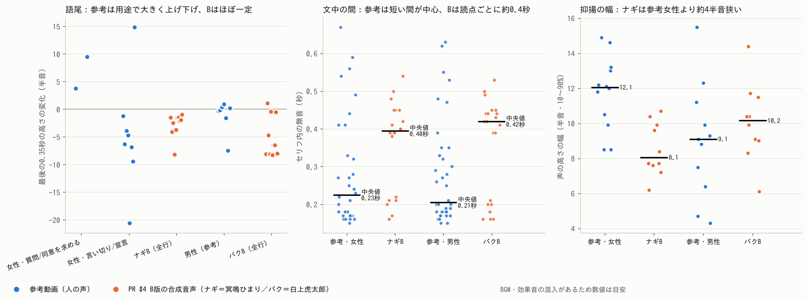

# 声の参考動画の分析（2026-10-14）

> 状態：**分析結果と提案（ユーザー確認待ち）**。ルール文書・casting・音声はまだ変えていない。
> 素材：ユーザー提供の画面録画2本（女性＝ナギの参考、男性＝バクの参考）
> - クリップA（92秒）：アニメの試合実況。女性の実況と男性の解説の掛け合い
> - クリップB（44秒）：アニメの男性キャラの語り（あいさつ・名乗り・評価）
> 比較相手：PR #4 B版の合成音声20本（ナギ＝冥鳴ひまり、バク＝白上虎太郎）
> 方法：Praat（parselmouth）で声の高さを10ms刻みで測定。字幕の切り替わりで発話区間を決め、男女は声の高さで確認。
> 注意：参考はBGM・効果音入りの録画なので数値は目安。日本語の文字起こしはモデル取得先が遮断されていて**できていない**（字幕は英語のみ）ため、セリフの文言には依存しない指標だけを使った。
> 参考にするのは抑揚の「型」だけ。声そのもの・セリフはコピーしない。

---

## 1. 数値の比較（発話ごとの中央値）

| | 参考・女性（12発話） | ナギB（10本） | 参考・男性A（7発話） | 参考・男性B（4発話） | バクB（10本） |
| --- | --- | --- | --- | --- | --- |
| 声の高さ | **343Hz** | 268Hz（約4半音低い） | 224Hz | **111Hz** | 約150Hz（叫びは246〜257Hz） |
| 抑揚の幅（10〜90%） | **12.1半音** | 8.1半音 | 9.9半音 | **5.6半音** | 10.2半音 |
| 文中の無音（中央値） | **0.23秒** | 0.40秒 | 0.21秒 | | 0.42秒 |
| 話速（音節/秒・推定） | 8.6 | 8.4 | 8.2 | 7.1 | 7.9 |
| 語尾（最後0.35秒の変化） | 用途で −21〜＋15半音 | −1〜−4（−8が1本） | ほぼ ±1 | 平ら〜−7.5 | −5〜−8が多い |

※ 男性の参考は2種類あり性格が違う：Aの解説役は高めで動きが大きい、Bの語りは低く・幅が狭く・語尾を平らに保つ。

---

## 2. 分かったこと（弱点の正体）

### ① 語尾が「いつも同じ形」── いちばん大きい差
- **参考の女性は、語尾で感情を出している。**
  - 質問・同意を求める：最後を **＋4〜＋10半音** 上げ、質問では最後の音を **約0.8秒** 伸ばす。
  - 宣言（「試合終了」型）：最後で **約−20半音** 落とし、最後の音を **約0.65秒** 伸ばす。
  - 説明・実況：**−4〜−9半音** で言い切る。
- **ナギBは、どの行も −1〜−4半音のゆるい下がり**（casting の drawl が `fall=0.0` で、全行の語尾を同じ1.25倍に伸ばす）。質問も皮肉も言い切りも同じ語尾なので、平板で「読み上げ」に聞こえる。
- **バクBは逆に、ほとんどの行で −5〜−8半音 しっかり落ちる。** 参考の男性（どちらも）は普段の語尾を **ほぼ平ら（±1半音）** に保っていて、そのほうがくだけた会話に聞こえる。バクの「落ちる語尾」が、元気な関西弁なのに説明口調っぽく聞こえる原因と考えられる。

### ② 文中の間が「全部同じ長さ」
- 参考は **0.15〜0.3秒の短い間が大半**で、0.4〜0.6秒の長い間は大きな区切りにだけ出る（2段階）。
- B版は **読点ごとに約0.4秒**（ナギ中央値0.40、バク0.42）。区切りの大小がなく、どの読点でも同じだけ止まる。前回指摘した「間延び」の音響的な正体はこれ。
- VOICEVOX は読点で「止まる／止まらない」しか選べないので、**台本の書き方だけでは0.2秒の短い間は作れない**。

### ③ ナギは抑揚の幅が狭く、声も低め
- 幅は参考女性の約2/3（8.1 vs 12.1半音）、高さは約4半音低い。
- ただし参考女性は「実況アナウンサー」の明るさで、ナギは「冷静」のキャラ。高さをそのまま合わせる必要はない。**幅（特に語尾と強調語の動き）を広げるのが先**で、高さは聞き比べで決めたい。

### ④ バクの叫びは「別の声」になっている
- 叫び（`バク!:`）は別話者（ID 32）に切り替わり、普段の約150Hzから約250Hzへ **約9半音** 跳ぶ。参考の男性は興奮しても同じ声の延長で上がる。バクが「同じ人に聞こえない」ことがあるなら、これが原因。

---

## 3. 改善案

### 3-1. いますぐ台本でできること（システム変更なし）
- **質問は「？」で終える**＋バクは `mood=ask`。B2案の4・7・17行目はすでにこの形。
- **皮肉・宣言は短く言い切る**（「違反じゃない。」「間に合った者勝ち、だね。」）。語尾を名詞・「だ」で止めると下がりやすい。
- **読点は大きな区切りにだけ打つ**（B2案で28→14か所に減らし済み）。

→ ただし①②の本体（語尾の上げ下げの大きさ、0.2秒の短い間）は台本だけでは届かない。次の3-2が必要。

### 3-2. 声の作り方の変更案（**要承認**：`lab/tts.py` と `voice/casting_b.json`。映像は触らない）

| 案 | 中身 | 狙い | 根拠 |
| --- | --- | --- | --- |
| **A. 間を短く**（効果大） | `pauseLengthScale` をナギ・バクとも 1.0 → 約0.55（読点の間 約0.4秒 → 約0.22秒）。長く止めたい所は今までどおり `@dir pre/post` で | 参考の「短い間が中心」に合わせる | ② |
| **B. 語尾の型を1行ずつ指定**（効果大） | `@dir tail=` を追加。`up`＝最後の2拍を上げて最後の音を約1.8倍、`down`＝最後の3拍を大きく下げる、`flat`＝下げずに保つ、`long`＝最後の音を約2倍。量は参考の数値から：up ＋5〜8半音、down −7〜−10半音 | ①の解消。質問・皮肉・宣言を語尾で演じ分ける | ① |
| **C. バクの普段の語尾を平らに** | バクの既定の語尾を `flat` に（叫び・言い切りの行だけ `down`） | くだけた関西弁らしさ | ①（男性参考は±1半音） |
| **D. 強調語を少し強く** | `emph` の上げ幅 0.12 → 0.2 前後をAB | ナギの抑揚の幅を「全体」ではなく「核の語」で広げる | ③ |
| **E. ナギの高さ**（任意） | `pitch` 0.03 → 0.06 前後をAB | 少し明るく。冷静さが崩れるなら戻す | ③ |
| **F. バクの叫びの声**（任意） | 叫びでも普段の声（ID 12）のまま、`int`・`speed`・語尾 `up` で上げる案をAB | 普段と叫びで同じ人に聞こえるように | ④ |

- どれも **AB試聴用に別ファイルで作り、元の設定は残す**（ルール2-5どおり）。
- 実装は `lab/tts.py` の既存の語尾処理（drawl）と強調語の処理の延長で、数十行程度の見込み。

### 3-3. B2案に当てはめた場合の語尾指定（案Bが通った場合）

| 行 | セリフ | tail | 参考にした型 |
| --- | --- | --- | --- |
| 4 | 普通にって、違反ちゃうん？ | up | 女性の質問（＋4） |
| 5 | 違反じゃない。〜 | down（前半） | 言い切り |
| 7 | 5月以降だけ？ほな4月までに入れた台は？ | up | 確認の質問 |
| 9 | 出た、北斗無双。 | flat | 男性の短い感嘆 |
| 12 | 入るまでが半々だけどね。 | flat | 冷静な皮肉（下げない平らさ） |
| 13・15 | それな。〜／外せって決まりもないもんな。 | flat | 男性の普段の語尾（±1） |
| 17 | 〜勝負せなあかんの？ | up＋long | 同意を求める質問（＋9.5、0.8秒） |
| 19 | 規制が、北斗無双のライバル止めてくれとるやん！ | up | 叫び |
| 20 | 間に合った者勝ち、だね。 | down＋long | 「試合終了」型の宣言（大きく落として伸ばす） |

---

## 4. 確認したいこと
1. **3-2のA〜Dを入れて、AB試聴用の音声を作ってよいか**（E・Fは任意）。作るのは音声だけで、動画にはしない。
2. **バクの参考はどちらの男性に寄せるか**：A（高め・動きが大きい解説役）か、B（低く・幅が狭く・余裕のある語り）か。今のバクの高さ（約150Hz）と元気キャラから見ると、**語尾の平らさはB、動きの大きさはA** の組み合わせを推奨。
3. ナギの高さ（案E）は上げたいか、冷静さ優先で今のままか。
4. 日本語の文字起こしができていないため、「どの言葉で上げているか」までは分かっていない。気になる箇所があれば、秒数とセリフ（日本語）を教えてもらえれば、そこを詳しく測る。
